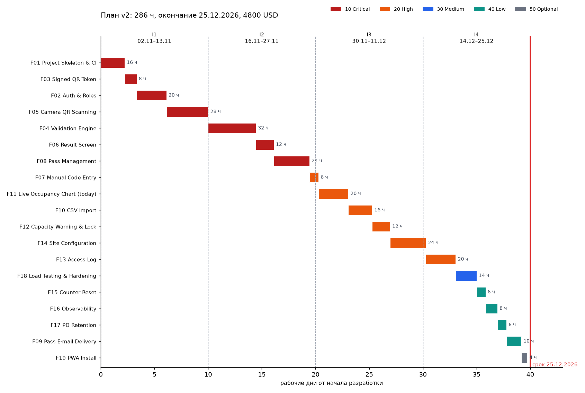

# План реализации QRGate — версия v2

План после первого раунда обсуждения (27.10.2026). Сформирован скриптом `tools/plan_render.py`.

## Исходные данные

- Начало разработки: 02.11.2026; длина итерации — 2 недели (10 рабочих дней); срок сдачи: 25.12.2026.
- Middle-разработчик: 8 оплачиваемых часов в день, из них 7,2 ч на задачи (10 % — встречи, демонстрации, ревью).
- Объём плана: **286 ч**; ёмкость четырёх итераций: **288 ч**.
- Окончание работ по плану: **25.12.2026** — в срок.

## Итерации

| Итерация | Даты | Ёмкость, ч | Запланировано, ч | Функции |
|----------|------|-----------:|-----------------:|---------|
| I1 | 02.11.2026 – 13.11.2026 | 72 | 72 | F01 (16), F03 (8), F02 (20), F05 (28) |
| I2 | 16.11.2026 – 27.11.2026 | 72 | 72 | F04 (32), F06 (12), F08 (24), F07 (4) |
| I3 | 30.11.2026 – 11.12.2026 | 72 | 72 | F07 (2), F11 (20), F10 (16), F12 (12), F14 (22) |
| I4 | 14.12.2026 – 25.12.2026 | 72 | 70 | F14 (2), F13 (20), F18 (14), F15 (6), F16 (8), F17 (6), F09 (10), F19 (4) |

## Функции

| ID | Feature | Priority | Часы | Исполнитель | Начало | Окончание | Итерации |
|----|---------|---------:|-----:|-------------|--------|-----------|----------|
| F01 | Project Skeleton & CI | 10 | 16 | Middle | 02.11.2026 | 04.11.2026 | I1 |
| F03 | Signed QR Token | 10 | 8 | Middle | 04.11.2026 | 05.11.2026 | I1 |
| F02 | Auth & Roles | 10 | 20 | Middle | 05.11.2026 | 10.11.2026 | I1 |
| F05 | Camera QR Scanning | 10 | 28 | Middle | 10.11.2026 | 13.11.2026 | I1 |
| F04 | Validation Engine | 10 | 32 | Middle | 16.11.2026 | 20.11.2026 | I2 |
| F06 | Result Screen | 10 | 12 | Middle | 20.11.2026 | 24.11.2026 | I2 |
| F08 | Pass Management | 10 | 24 | Middle | 24.11.2026 | 27.11.2026 | I2 |
| F07 | Manual Code Entry | 20 | 6 | Middle | 27.11.2026 | 30.11.2026 | I2, I3 |
| F11 | Live Occupancy Chart (today) | 20 | 20 | Middle | 30.11.2026 | 03.12.2026 | I3 |
| F10 | CSV Import | 20 | 16 | Middle | 03.12.2026 | 07.12.2026 | I3 |
| F12 | Capacity Warning & Lock | 20 | 12 | Middle | 07.12.2026 | 08.12.2026 | I3 |
| F14 | Site Configuration | 20 | 24 | Middle | 08.12.2026 | 14.12.2026 | I3, I4 |
| F13 | Access Log | 20 | 20 | Middle | 14.12.2026 | 17.12.2026 | I4 |
| F18 | Load Testing & Hardening | 30 | 14 | Middle | 17.12.2026 | 18.12.2026 | I4 |
| F15 | Counter Reset | 40 | 6 | Middle | 18.12.2026 | 21.12.2026 | I4 |
| F16 | Observability | 40 | 8 | Middle | 21.12.2026 | 22.12.2026 | I4 |
| F17 | PD Retention | 40 | 6 | Middle | 22.12.2026 | 23.12.2026 | I4 |
| F09 | Pass E-mail Delivery | 40 | 10 | Middle | 23.12.2026 | 25.12.2026 | I4 |
| F19 | PWA Install | 50 | 4 | Middle | 25.12.2026 | 25.12.2026 | I4 |

Перенесены в релиз 3 (вне плана): F20 Occupancy History & Backfill.

## Стоимость

| Исполнитель | Ставка, USD/ч | Оплачиваемые часы | Сумма, USD |
|---|---:|---:|---:|
| Middle | 15 | 320 | 4800 |
| **Итого** | | | **4800** |

