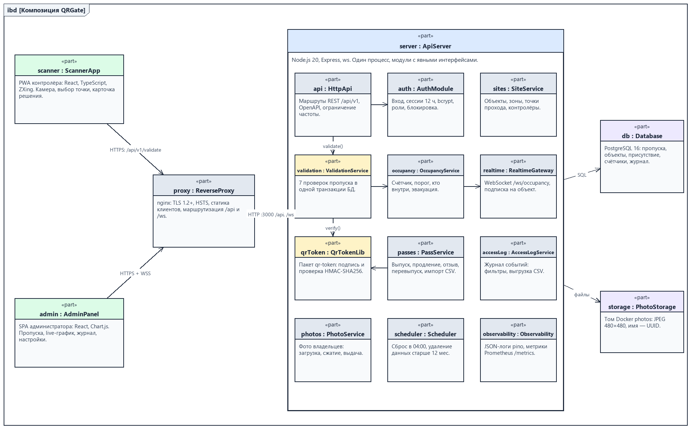
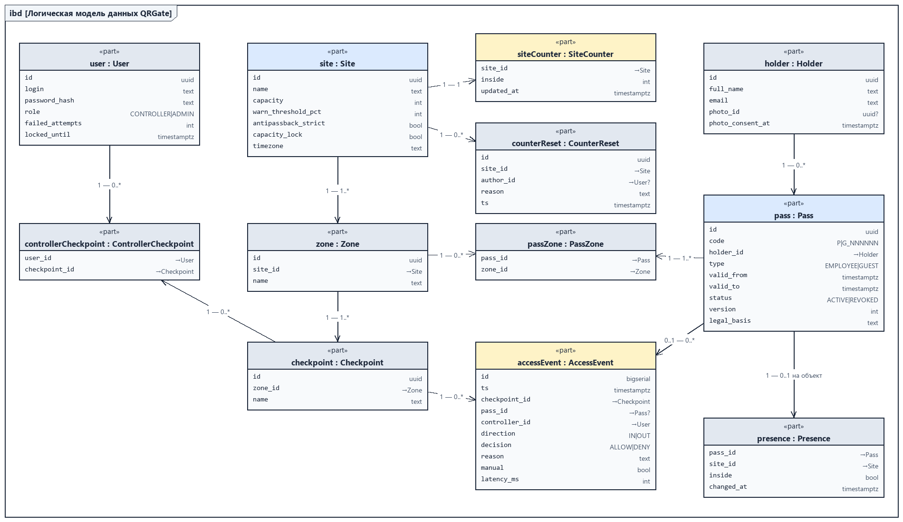
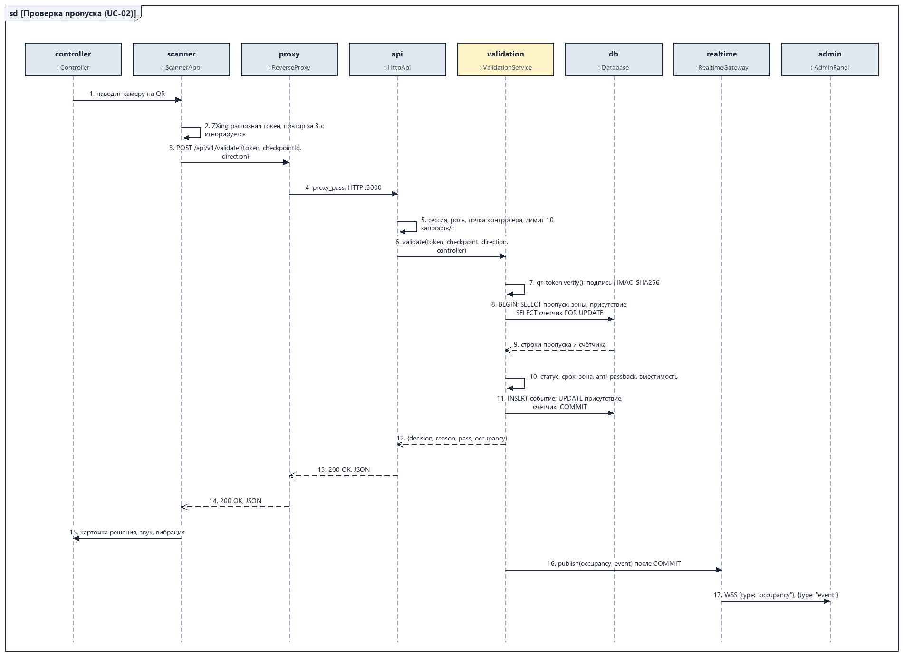
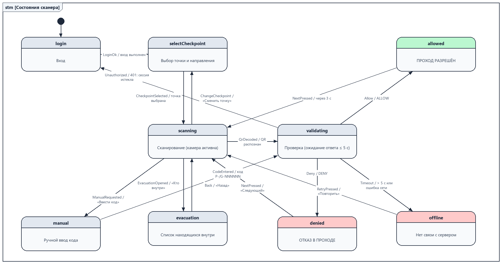
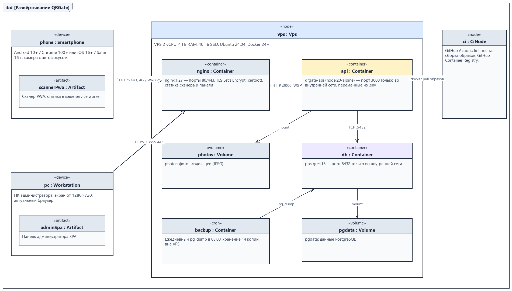
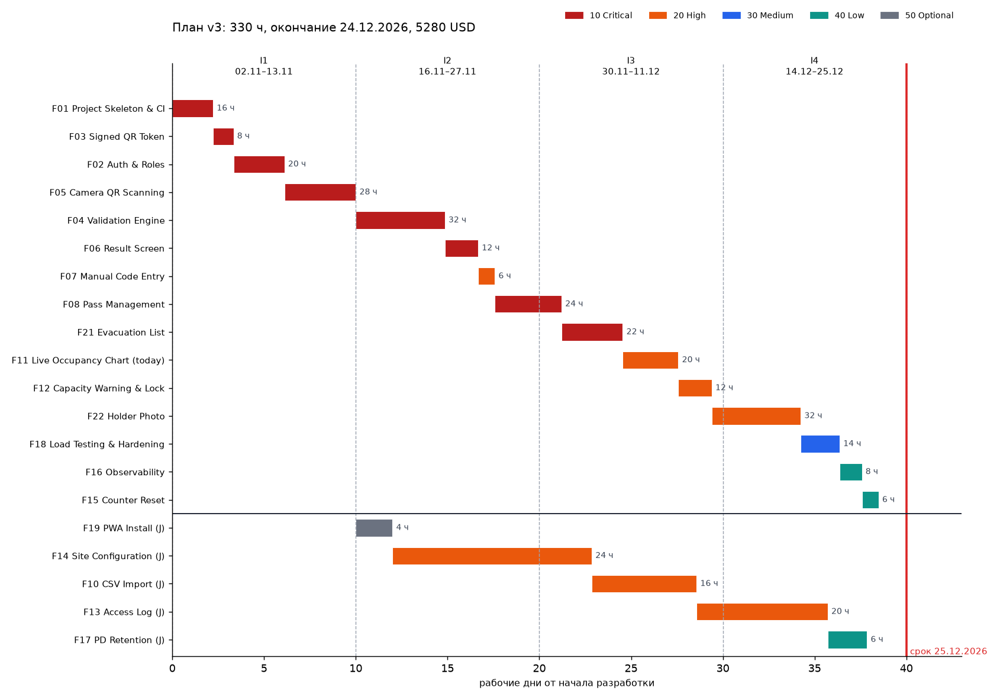

# Описание дизайна программного обеспечения

Для QRGate — системы контроля доступа по QR-пропускам

Версия 0.3

Подготовил Гамза Григорий Александрович, группа 439401

БГУИР, кафедра ЭВМ

29.10.2026

## Оглавление

<!-- TOC -->
* [1. Введение](#1-introduction)
  * [1.1 Назначение документа](#11-document-purpose)
  * [1.2 Область применения](#12-subject-scope)
  * [1.3 Определения, акронимы и сокращения](#13-definitions-acronyms-and-abbreviations)
  * [1.4 Ссылки](#14-references)
  * [1.5 Обзор документа](#15-document-overview)
* [2. Обзор дизайна](#2-design-overview)
  * [2.1 Задачи стейкхолдеров](#21-stakeholder-concerns)
  * [2.2 Выбранные точки зрения](#22-selected-viewpoints)
* [3. Проектные представления](#3-design-views)
* [4. Решения](#4-decisions)
* [5. Приложения](#5-appendixes)
<!-- TOC -->

## История изменений

| Name | Date | Reason For Changes | Version |
|------|------|--------------------|---------|
| Гамза Г. А. | 26.10.2026 | Первая редакция по SRS 0.2: представления, ADR-0001 – ADR-0007, бэклог и план v1 | 0.1 |
| Гамза Г. А. | 27.10.2026 | Первый раунд обсуждения с заказчиком: live-график только за сутки (ADR-0005), изменены приоритеты, план v2 | 0.2 |
| Гамза Г. А. | 29.10.2026 | Второй раунд: список эвакуации (F21), фото владельца (F22, ADR-0008), отказ от e-mail в релизе 2, junior-разработчик, план v3 | 0.3 |

---

## 1. Введение {#1-introduction}

Документ описывает, **как** будет построена система QRGate, требования к которой зафиксированы в [SRS](../srs/srs-qrgate.md). Он связывает требования SRS с архитектурными элементами, решениями ADR и планом реализации по итерациям.

### 1.1 Назначение документа {#11-document-purpose}

SDD служит руководством к действию для команды разработки: middle-разработчика (он же архитектор) и junior-разработчика, подключаемого со второй итерации. По документу команда реализует компоненты и интерфейсы, тестировщик строит интеграционные и нагрузочные тесты, заказчик понимает, из чего складываются сроки и стоимость. Связанные документы: [SRS](../srs/srs-qrgate.md), протоколы решений [`docs/decisions`](../docs/decisions), бэклог и планы [`docs/plan`](../docs/plan), переписка с заказчиком [`docs/plan/correspondence.md`](../docs/plan/correspondence.md).

### 1.2 Область применения {#12-subject-scope}

Проектируемая система — **QRGate**, релизы 1.0 (MVP, 11.12.2026, конец итерации I3) и 2.0 (25.12.2026, конец итерации I4). Система состоит из мобильного веб-сканера (PWA), панели администратора (SPA), API-сервера с WebSocket-каналом и базы данных PostgreSQL. Возможности связаны с бизнес-целями SRS: быстрая проверка пропуска (BG-1), исключение прохода по недействительным пропускам (BG-2), заполняемость в реальном времени (BG-3).

**Входит:** все функции бэклога с приоритетом 10–50, кроме перенесённых в релиз 3 ([`backlog.md`](../docs/plan/backlog.md)).
**Не входит:** отправка пропусков по e-mail (F09, исключена заказчиком 28.10.2026), история заполняемости за 7 дней (F20), офлайн-режим сканера и интеграция с турникетами (релиз 3).

### 1.3 Определения, акронимы и сокращения {#13-definitions-acronyms-and-abbreviations}

| Term | Definition |
|------|------------|
| ADR | Architectural Decision Record — запись значимого архитектурного решения с обоснованием |
| API | Application Programming Interface — набор определений и протоколов для создания и интеграции прикладного ПО |
| Fail-closed | Поведение, при котором отказ компонента приводит к запрету действия, а не к разрешению |
| HMAC | Hash-based Message Authentication Code — код аутентификации сообщения на основе хеш-функции и секретного ключа |
| Junior | Начинающий разработчик, работающий под наставничеством middle-разработчика |
| Middle | Разработчик среднего уровня, самостоятельно реализующий функции |
| PWA | Progressive Web App — веб-приложение, устанавливаемое на главный экран |
| SDD | Software Design Description — документ, описывающий, как будет построено ПО |
| SPA | Single Page Application — одностраничное веб-приложение |
| VPS | Virtual Private Server — виртуальный выделенный сервер |
| Итерация | Двухнедельный цикл разработки (10 рабочих дней), заканчивающийся демонстрацией заказчику |
| Функция бэклога | Единица планирования F01–F22 с приоритетом, оценкой в часах и декомпозицией на задачи |

Остальные термины — в разделе 1.3 SRS.

### 1.4 Ссылки {#14-references}

| Документ | Версия / дата | Расположение | Статус |
|----------|---------------|--------------|--------|
| IEEE 1016-2009. Software Design Descriptions | 2009 | ieee.org | Нормативная |
| ISO/IEC/IEEE 42010:2011. Architecture description | 2011 | iso.org | Нормативная |
| SRS QRGate | 0.3 | [`srs/srs-qrgate.md`](../srs/srs-qrgate.md) | Нормативная |
| ADR-0001 – ADR-0008 | 26–29.10.2026 | [`docs/decisions`](../docs/decisions) | Нормативная |
| Бэклог и планы v1, v2, v3 | 29.10.2026 | [`docs/plan`](../docs/plan) | Нормативная (план v3) |
| MADR 4.0 | 2024 | adr.github.io/madr | Справочная |
| OMG SysML v2 Specification | 2.0 | omg.org | Справочная |
| Шаблон SDD кафедры ЭВМ | — | [`sdd-template.md`](sdd-template.md) | Нормативная |

### 1.5 Обзор документа {#15-document-overview}

Раздел 2 перечисляет стейкхолдеров и выбранные точки зрения. Раздел 3 содержит проектные представления с идентификаторами `NNN-название`, ссылками на требования SRS и решения раздела 4. Раздел 4 кратко перечисляет решения, полный текст каждого — в отдельном файле ADR. Раздел 5 содержит матрицу трассировки и сводку плана реализации. Диаграммы построены из моделей SysML v2 в [`sdd/models`](models) скриптом `python tools/sdd_render.py`, планы — скриптом `python tools/plan_render.py`. Изменения вносятся через pull request и отражаются в истории изменений.

---

## 2. Обзор дизайна {#2-design-overview}

### 2.1 Задачи стейкхолдеров {#21-stakeholder-concerns}

| Стейкхолдер | Основные задачи (concerns) | Представления |
|-------------|----------------------------|---------------|
| Заказчик (администрация объекта) | Сроки, стоимость, безопасность прохода, требования пожарной безопасности | 001, 006, 009, раздел 5 |
| Контролёр | Скорость и однозначность решения, работа одной рукой | 006, 007 |
| Администратор | Актуальная заполняемость, управление пропусками, разбор инцидентов | 002, 004, 005 |
| Разработчики (middle, junior) | Границы модулей, контракты, алгоритм валидации, параллелизм | 002, 003, 004, 005, 008, 010, 011 |
| Эксплуатация | Установка, обновление, резервное копирование, ресурсы | 009, 012 |
| Ответственный за персональные данные | Минимизация, сроки хранения, удаление, фото | 004, 005 |

### 2.2 Выбранные точки зрения {#22-selected-viewpoints}

Из пятнадцати точек зрения шаблона выбраны те, которые адресуют задачи из 2.1. Языки описания — SysML v2 (текстовая нотация, диаграммы ibd, sd, stm), таблицы и псевдокод.

| Точка зрения | Адресует | Язык | Представление |
|--------------|----------|------|---------------|
| Контекст | Границы, акторы, внешние системы | SysML v2 ibd (из SRS) | 001 |
| Композиция | Основные компоненты и их ответственность | SysML v2 ibd | 002 |
| Структура | Внутреннее устройство API-сервера и монорепозитория | Таблица, дерево каталогов | 003 |
| Информация | Постоянные данные, ограничения целостности | SysML v2 ibd (логическая модель) | 004 |
| Интерфейс | Контракты REST и WebSocket | Таблица эндпоинтов | 005 |
| Взаимодействие | Сценарий проверки пропуска | SysML v2 sd | 006 |
| Динамика состояний | Режимы работы сканера | SysML v2 stm | 007 |
| Алгоритм | Цепочка проверок валидации | Псевдокод | 008 |
| Развёртывание | Узлы, контейнеры, сети | SysML v2 ibd | 009 |
| Параллелизм | Одновременные проверки на одном объекте | Текст, таблица | 010 |
| Паттерны | Применённые архитектурные и проектные паттерны | Таблица | 011 |
| Ресурсы | Память, соединения, диск | Таблица распределения ресурсов | 012 |

Точки зрения «Логическое представление», «Физическое представление» и «Зависимости» не выделены отдельно: типы данных описаны в 004 и 005, физическая платформа — в 009, зависимости модулей — в 002 и 003.

---

## 3. Проектные представления {#3-design-views}

### 001-context

- **ID**: 001-context
- **Title**: Контекст системы
- **Viewpoint**: Контекст
- **Representation**: контекстная диаграмма из SRS (рисунок 1 SRS, модель [`qrgate-context.sysml`](../srs/models/qrgate-context.sysml)). Акторы: посетитель, контролёр, администратор; внешние системы: PostgreSQL. Внешний SMTP-сервис из контекста SRS 0.1 в релизах 1–2 не используется (F09 перенесена в релиз 3).
- **More Information**: SRS 1.2, 2.1; ADR-0006.

### 002-composition

- **ID**: 002-composition
- **Title**: Композиция: клиенты, прокси, модульный монолит, хранилища
- **Viewpoint**: Композиция



*Рисунок 1 – Композиция QRGate (SysML v2, [`models/qrgate-components.sysml`](models/qrgate-components.sysml))*

- **Representation**:

| Компонент | Ответственность | Функции бэклога | Требования SRS |
|-----------|-----------------|-----------------|----------------|
| scanner : ScannerApp | Камера, распознавание QR, выбор точки, карточка решения, список эвакуации | F05, F06, F07, F19, F21 | REQ-FUNC-001–003, 007, 014; REQ-INT-001, 002, 004 |
| admin : AdminPanel | Пропуска, импорт, live-график, журнал, настройки, фото | F08, F10–F14, F21, F22 | REQ-FUNC-008–012, 014, 015; REQ-INT-003 |
| proxy : ReverseProxy | TLS, HSTS, статика, маршрутизация `/api`, `/ws` | F01, F18 | REQ-SEC-002 |
| api : HttpApi | Маршруты REST, OpenAPI, ограничение частоты | F01, F04 | REQ-INT-005, REQ-SEC-004 |
| auth : AuthModule | Вход, сессии, роли, блокировка | F02 | REQ-FUNC-001, REQ-SEC-001, 003 |
| validation : ValidationService | Решение ALLOW/DENY в одной транзакции | F04 | REQ-FUNC-004, 006, REQ-REL-002 |
| qrToken : QrTokenLib | Подпись и проверка токена (отдельный пакет) | F03 | REQ-FUNC-005 |
| passes : PassService | Жизненный цикл пропусков, импорт CSV | F08, F10 | REQ-FUNC-008 |
| occupancy : OccupancyService | Счётчик, порог, блокировка, кто внутри | F11, F12, F21 | REQ-FUNC-009, 010, 014 |
| realtime : RealtimeGateway | WebSocket-рассылка | F11 | REQ-INT-006, REQ-REL-003 |
| sites : SiteService | Объекты, зоны, точки, контролёры | F14 | REQ-FUNC-012 |
| accessLog : AccessLogService | Журнал, фильтры, CSV | F13 | REQ-FUNC-011 |
| photos : PhotoService | Фото владельцев | F22 | REQ-FUNC-015, REQ-SEC-005-2 |
| scheduler : Scheduler | Сброс в 04:00, удаление старых данных | F15, F17 | REQ-FUNC-013, REQ-SEC-005-2 |
| observability : Observability | Логи, метрики | F16 | REQ-OBS-001 |
| db : Database | Постоянное хранение | F01, F04 | REQ-REL-002, REQ-PERF-003 |
| storage : PhotoStorage | Файлы фото | F22 | REQ-FUNC-015 |

Стрелки на рисунке 1 показывают направление зависимости «использует». Модуль `validation` не зависит от HTTP: его вызывает `api`, а после фиксации транзакции он передаёт событие в `occupancy`, который публикует его через `realtime`.

- **More Information**: ADR-0001, ADR-0002, ADR-0005.

### 003-structure

- **ID**: 003-structure
- **Title**: Структура монорепозитория и модулей сервера
- **Viewpoint**: Структура
- **Representation**:

```
qrgate/
├── apps/
│   ├── scanner/        # React PWA: pages/, camera/, state/ (автомат 007)
│   ├── admin/          # React SPA: passes/, dashboard/, log/, settings/, evacuation/
│   └── api/            # Express: src/modules/<module>/{index.ts, routes.ts, service.ts, repo.ts}
├── packages/
│   ├── qr-token/       # sign/verify, без зависимостей от Express и БД (SRS 3.5.5)
│   └── contracts/      # типы запросов/ответов, общие для клиентов и сервера (из OpenAPI)
├── db/migrations/      # node-pg-migrate
├── docs/api/openapi.yaml
├── deploy/             # docker-compose.yml, nginx.conf, .env.example
└── tests/              # unit, integration, api, load (k6), e2e
```

Каждый модуль сервера состоит из слоёв: `routes` (HTTP, валидация входа zod) → `service` (бизнес-логика) → `repo` (SQL). Модули обращаются друг к другу только через `index.ts`; это проверяется ESLint-правилом в CI (ADR-0001). Сервисы получают зависимости через параметры фабрики (`createValidationService({ db, token, occupancy })`), что позволяет тестировать их без БД.

- **More Information**: ADR-0001; REQ-MAINT-001, REQ-BUILD-001.

### 004-information

- **ID**: 004-information
- **Title**: Логическая модель данных
- **Viewpoint**: Информация



*Рисунок 2 – Логическая модель данных (SysML v2, [`models/qrgate-data.sysml`](models/qrgate-data.sysml))*

- **Representation**: ключевые ограничения целостности:
  - `pass.code` уникален, формат `^[PG]-\d{6}$`; `pass.version` увеличивается при отзыве и перевыпуске (REQ-FUNC-005);
  - `presence (pass_id, site_id)` — первичный ключ; одна запись на пропуск и объект (anti-passback, REQ-FUNC-006);
  - `site_counter.inside >= 0`; изменяется только в транзакции валидации или сброса (ADR-0004);
  - `access_event` — только вставка; индексы `(checkpoint_id, ts)`, `(pass_id, ts)` для журнала (REQ-FUNC-011); секционирование по месяцам упрощает удаление событий старше 12 месяцев (REQ-SEC-005-2);
  - `holder` содержит только ФИО, e-mail, ссылку на фото и дату согласия (REQ-SEC-005-2); `access_event` не содержит ФИО — его получают соединением с `pass` и `holder`.
- **More Information**: ADR-0004, ADR-0008; REQ-REL-002, REQ-SEC-005-2, REQ-COMP-001.

### 005-interface

- **ID**: 005-interface
- **Title**: Контракты REST API и WebSocket
- **Viewpoint**: Интерфейс
- **Representation**: все эндпоинты под `/api/v1`, формат JSON, аутентификация — cookie сессии `HttpOnly; Secure; SameSite=Strict`. Полный контракт — `docs/api/openapi.yaml` (создаётся в F01, дополняется в каждой функции).

| Метод и путь | Роль | Назначение | Функция |
|--------------|------|------------|---------|
| `POST /auth/login`, `POST /auth/logout` | все | Вход и выход | F02 |
| `GET /me/checkpoints` | контролёр | Точки прохода контролёра | F02 |
| `POST /validate` | контролёр | Проверка пропуска (контракт REQ-INT-005) | F04 |
| `POST /validate/manual` | контролёр | Проверка по номеру `P-/G-NNNNNN` | F07 |
| `GET/POST/PATCH /passes`, `POST /passes/{id}/revoke`, `/reissue` | администратор | Пропуска | F08 |
| `GET /passes/{id}/qr.png` | администратор | QR в PNG | F08 |
| `POST /passes/import` | администратор | Импорт CSV, ответ — отчёт по строкам | F10 |
| `GET /sites/{id}/occupancy/today` | оба | Данные графика за сутки | F11 |
| `GET /sites/{id}/inside` | оба | Кто внутри: список эвакуации, `?format=pdf` | F21 |
| `GET /events`, `GET /events.csv` | администратор | Журнал, выгрузка | F13 |
| `GET/POST/PATCH /sites`, `/zones`, `/checkpoints`, `/users` | администратор | Настройка объекта | F14 |
| `POST /sites/{id}/reset` | администратор | Ручной сброс счётчика | F15 |
| `PUT /holders/{id}/photo`, `GET /photos/{id}` | администратор / оба | Фото владельца | F22 |
| `WS /ws/occupancy?site={id}` | оба | Сообщения `occupancy`, `event`, `warning` | F11, F12 |
| `GET /metrics` | только внутренняя сеть | Метрики Prometheus | F16 |

Ошибки возвращаются в формате `{ "error": code, "message": text }` с кодами HTTP 400, 401, 403, 404, 409, 429. Изменения, ломающие совместимость, — только с переходом на `/api/v2` (SRS 3.5.10).

- **More Information**: ADR-0003, ADR-0005, ADR-0008; REQ-INT-005, REQ-INT-006.

### 006-validate-interaction

- **ID**: 006-validate-interaction
- **Title**: Взаимодействие при проверке пропуска
- **Viewpoint**: Взаимодействие



*Рисунок 3 – Диаграмма последовательности проверки пропуска (SysML v2, [`models/qrgate-validate-sequence.sysml`](models/qrgate-validate-sequence.sysml))*

- **Representation**: «счастливый путь» показан на рисунке 3. Пути отказа: неверная подпись — ответ `DENY_BAD_SIGNATURE` после шага 7 без обращения к БД; превышение лимита — 429 на шаге 5; ошибка БД — откат транзакции, 503, сканер показывает «Нет связи» (fail-closed); тайм-аут 5 с на сканере — состояние `offline` (представление 007). Бюджет времени: шаги 3–14 ≤ 500 мс p95 (REQ-PERF-001), шаги 2–15 ≤ 1,5 с (REQ-PERF-002). Фото владельца (F22) загружается сканером отдельным запросом после шага 14 и не задерживает показ решения.
- **More Information**: ADR-0004, ADR-0005, ADR-0006; REQ-FUNC-004, REQ-REL-002.

### 007-scanner-states

- **ID**: 007-scanner-states
- **Title**: Состояния сканера
- **Viewpoint**: Динамика состояний



*Рисунок 4 – Диаграмма состояний сканера (SysML v2, [`models/qrgate-scanner-states.sysml`](models/qrgate-scanner-states.sysml))*

- **Representation**: камера активна только в состоянии `scanning`; в `validating` повторные распознавания игнорируются. Из `allowed` возврат автоматический через 3 с, из `denied` и `offline` — только по кнопке (REQ-FUNC-007, REQ-REL-001). Ответ 401 в любом состоянии переводит в `login`. Состояние `evacuation` (F21) показывает список находящихся внутри без выхода из сессии. Автомат реализуется как редьюсер React (`useReducer`) с таблицей переходов, покрытой модульными тестами.
- **More Information**: ADR-0002, ADR-0006.

### 008-algorithm

- **ID**: 008-algorithm
- **Title**: Алгоритм валидации пропуска
- **Viewpoint**: Алгоритм
- **Representation**:

```
validate(token, checkpointId, direction, controller):
  if not qrToken.verify(token): return deny(BAD_SIGNATURE)            # без БД
  (passId, version) = qrToken.parse(token)
  BEGIN
    cp      = SELECT checkpoint, zone, site WHERE id = checkpointId
    counter = SELECT site_counter WHERE site_id = cp.site FOR UPDATE  # ADR-0004
    pass    = SELECT pass, zones, presence WHERE id = passId
    reason  = first failing of:
      pass is null                                 -> NOT_FOUND
      pass.status = REVOKED or pass.version != version -> REVOKED
      now not in [pass.valid_from, pass.valid_to]  -> EXPIRED
      cp.zone not in pass.zones                    -> ZONE
      site.antipassback_strict and direction = IN  and presence.inside     -> ALREADY_INSIDE
      site.antipassback_strict and direction = OUT and not presence.inside -> NOT_INSIDE
      direction = IN and site.capacity_lock and counter.inside >= site.capacity -> CAPACITY
    INSERT access_event(..., decision, reason, latency_ms)
    if reason is none: UPDATE presence; UPDATE site_counter (+1 / -1)
  COMMIT
  occupancy.publish(site, counter, event)          # после COMMIT
  return { decision, reason, pass, occupancy }
```

Порядок проверок задан REQ-FUNC-004; первая нарушенная определяет код. Сложность — O(1) запросов на проверку (3 SELECT, 1–3 записи) независимо от объёма журнала.

- **More Information**: ADR-0003, ADR-0004; REQ-FUNC-004, 005, 006, 010; тесты `tests/unit/validation.test.ts`.

### 009-deployment

- **ID**: 009-deployment
- **Title**: Развёртывание
- **Viewpoint**: Развёртывание



*Рисунок 5 – Диаграмма развёртывания (SysML v2, [`models/qrgate-deployment.sysml`](models/qrgate-deployment.sysml))*

- **Representation**: окружения — `dev` (ноутбук разработчика, `docker compose` с MailHog не требуется после исключения F09), `staging` (тот же VPS, отдельный compose-проект на поддомене, для демонстраций заказчику в конце итерации) и `prod`. Конвейер: push → GitHub Actions (lint, тесты, gitleaks, сборка образов) → GitHub Container Registry → на VPS `docker compose pull && docker compose up -d` в окне 22:00–07:00. Наружу открыты только порты 80 (редирект) и 443.
- **More Information**: ADR-0007; REQ-INST-001, REQ-BUILD-001, REQ-SEC-002, REQ-AVAIL-001.

### 010-concurrency

- **ID**: 010-concurrency
- **Title**: Параллельные проверки
- **Viewpoint**: Параллелизм
- **Representation**: Node.js обрабатывает запросы в одном потоке событий; параллельность возникает на уровне БД (пул 20 соединений). Гонки исключаются блокировкой строки счётчика объекта: проверки одного объекта выполняются последовательно, разных объектов — параллельно.

| Ситуация | Механизм | Результат |
|----------|----------|-----------|
| Два сканера одновременно пропускают 400-го и 401-го человека | `FOR UPDATE` на `site_counter` | Второй получает `DENY_CAPACITY` |
| Один пропуск предъявлен на двух входах одновременно | Та же блокировка + `presence` | Второй получает `DENY_ALREADY_INSIDE` |
| Сброс в 04:00 во время проверки | Сброс берёт ту же блокировку | Проверка выполняется до или после сброса целиком |
| Рассылка WebSocket во время отката | Публикация только после `COMMIT` | Клиенты не видят отменённых изменений |

- **More Information**: ADR-0004; REQ-REL-002, тест `tests/integration/concurrency.test.ts`.

### 011-patterns

- **ID**: 011-patterns
- **Title**: Применённые паттерны
- **Viewpoint**: Паттерны
- **Representation**:

| Паттерн | Где применён | Зачем |
|---------|--------------|-------|
| Modular Monolith | API-сервер | Простота при сохранении границ (ADR-0001) |
| Layered (routes → service → repo) | Каждый модуль сервера | Тестируемость, замена хранилища |
| Chain of Responsibility | Цепочка проверок валидации (008) | Порядок кодов отказа, добавление проверок без изменения остальных |
| Unit of Work | Транзакция валидации | Атомарность REQ-REL-002 |
| Publish/Subscribe | `occupancy` → `realtime` → клиенты | Развязка расчёта и доставки (ADR-0005) |
| State Machine | Сканер (007) | Предсказуемое поведение UI, fail-closed |
| Dependency Injection (фабрики) | Сервисы | Модульные тесты без БД (REQ-MAINT-001) |
| Reverse Proxy | nginx | TLS, статика, единый домен для cookie |

- **More Information**: ADR-0001, ADR-0004, ADR-0005.

### 012-resources

- **ID**: 012-resources
- **Title**: Ресурсы
- **Viewpoint**: Ресурсы
- **Representation**:

| Ресурс | Бюджет | Обоснование |
|--------|--------|-------------|
| Память контейнера `api` | ≤ 512 МБ | 70 WebSocket-соединений по ~50 КБ, пул БД, кэш сессий |
| Память `db` | ≤ 1,5 ГБ, `shared_buffers` 512 МБ | 10 000 пропусков и рабочий набор журнала в памяти |
| Соединения с БД | Пул 20 | 20 запросов/с × ~50 мс в транзакции = 1 активное соединение в среднем, запас ×20 |
| Диск БД | ≤ 2 ГБ | 2 млн событий × ~200 байт + индексы (REQ-PERF-003) |
| Диск фото | ≤ 500 МБ | 10 000 × ~40 КБ (ADR-0008) |
| Трафик сканера | ≤ 2 КБ на проверку, фото ~40 КБ один раз | REQ-PERF-002 при 4G |
| Ограничение частоты | 10 запросов/с на сканер | REQ-SEC-004 |

- **More Information**: ADR-0007, ADR-0008; REQ-PERF-001, REQ-PERF-003.

---

## 4. Решения {#4-decisions}

Полный текст каждого решения — в [`docs/decisions`](../docs/decisions) по шаблону MADR.

| ID | Title | Context | Options | Outcome | More Information |
|----|-------|---------|---------|---------|------------------|
| [ADR-0001](../docs/decisions/0001-modular-monolith-on-node-express.md) | Модульный монолит на Node.js и Express | 1–2 разработчика, транзакция валидации | Монолит; микросервисы; serverless | Монолит — атомарность и срок | 002, 003 |
| [ADR-0002](../docs/decisions/0002-browser-qr-scanning-with-zxing-pwa.md) | Сканирование в браузере: PWA + ZXing | CON-1, iOS Safari | ZXing; jsQR; Barcode Detection API; нативное | ZXing — работает на iOS | 002, 007 |
| [ADR-0003](../docs/decisions/0003-hmac-signed-qr-tokens.md) | QR — токен с HMAC-SHA256 | BG-2, CON-5 | UUID; HMAC; JWT Ed25519 | HMAC — короткий, неподделываемый, отзываемый | 005, 008 |
| [ADR-0004](../docs/decisions/0004-transactional-occupancy-counter-in-postgresql.md) | Счётчик — строка PostgreSQL с блокировкой | REQ-REL-002, гонки | Строка + FOR UPDATE; Redis; расчёт по журналу | Строка — одна ACID-транзакция | 004, 008, 010 |
| [ADR-0005](../docs/decisions/0005-websocket-push-for-live-occupancy.md) | Live-график — WebSocket, только сутки | BG-3, сокращение F11 | WebSocket; SSE; опрос | WebSocket — контракт REQ-INT-006 | 005, 006 |
| [ADR-0006](../docs/decisions/0006-fail-closed-scanner-without-offline-mode.md) | Сканер только онлайн, fail-closed | REQ-REL-001 | Fail-closed; офлайн-кэш; fail-open | Fail-closed — решение заказчика | 006, 007 |
| [ADR-0007](../docs/decisions/0007-single-vps-docker-compose-deployment.md) | Один VPS, Docker Compose | AS-4, бюджет | Compose; k3s; PaaS | Compose — просто и дёшево | 009 |
| [ADR-0008](../docs/decisions/0008-holder-photos-on-local-volume.md) | Фото на томе Docker | Новая функция F22 | Том; bytea; S3 | Том — дёшево, без третьих лиц | 004, 005, 012 |

---

## 5. Приложения {#5-appendixes}

### Приложение А. Сводка плана реализации

Бэклог — [`docs/plan/backlog.md`](../docs/plan/backlog.md), планы — [`plan-v1.md`](../docs/plan/plan-v1.md), [`plan-v2.md`](../docs/plan/plan-v2.md), [`plan-v3a.md`](../docs/plan/plan-v3a.md), [`plan-v3.md`](../docs/plan/plan-v3.md), переписка — [`correspondence.md`](../docs/plan/correspondence.md).

| Версия | Событие | Объём, ч | Окончание | Стоимость, USD |
|--------|---------|---------:|-----------|---------------:|
| v1 | Первоначальная оценка | 298 | 29.12.2026 (позже срока) | 5040 |
| v2 | Раунд 1: упрощён график, изменены приоритеты | 286 | 25.12.2026 | 4800 |
| v3a | Раунд 2: новый объём без изменения команды | 330 | 04.01.2027 (позже срока) | 5520 |
| **v3** | **Согласовано: junior с итерации 2** | **330** | **24.12.2026** | **5280** |



*Рисунок А.1 – Диаграмма Ганта согласованного плана v3*

### Приложение Б. Матрица трассировки

| Требование SRS | Представления | ADR | Функция | Итерация (v3) |
|----------------|---------------|-----|---------|---------------|
| REQ-FUNC-001, REQ-SEC-001, 003 | 002, 005 | — | F02 | I1 |
| REQ-FUNC-002, REQ-INT-001, 004, REQ-POC-001 | 002, 007 | 0002 | F05 | I1 |
| REQ-FUNC-003 | 005, 007 | — | F07 | I2 |
| REQ-FUNC-004, 006, REQ-INT-005, REQ-REL-002 | 006, 008, 010 | 0004 | F04 | I2 |
| REQ-FUNC-005, REQ-COMP-002 | 005, 008 | 0003 | F03 | I1 |
| REQ-FUNC-007, REQ-INT-002 | 007 | 0006 | F06 | I2 |
| REQ-FUNC-008 | 004, 005 | — | F08, F10 | I2–I3 |
| REQ-FUNC-009, REQ-INT-006, REQ-REL-003 | 005, 006 | 0005 | F11 | I3 |
| REQ-FUNC-010 | 008, 010 | 0004 | F12 | I3 |
| REQ-FUNC-011 | 004, 005 | — | F13 | I3–I4 |
| REQ-FUNC-012 | 005 | — | F14 | I2–I3 |
| REQ-FUNC-013 | 010 | 0004 | F15 | I4 |
| REQ-FUNC-014 (эвакуация) | 005, 007 | — | F21 | I3 |
| REQ-FUNC-015, REQ-SEC-005-2 (фото) | 004, 005, 012 | 0008 | F22 | I3–I4 |
| REQ-REL-001 | 006, 007 | 0006 | F05 | I1 |
| REQ-PERF-001 – 003, REQ-SEC-002, 004 | 006, 012 | 0004, 0007 | F04, F18 | I2, I4 |
| REQ-OBS-001 | 002 | — | F16 | I4 |
| REQ-SEC-005-2, REQ-COMP-001 | 004 | 0008 | F17 | I4 |
| REQ-INST-001, 002, REQ-BUILD-001 | 003, 009 | 0007 | F01, F19 | I1, I2 |
| REQ-INT-007 (e-mail) | — | — | F09 | релиз 3 |
