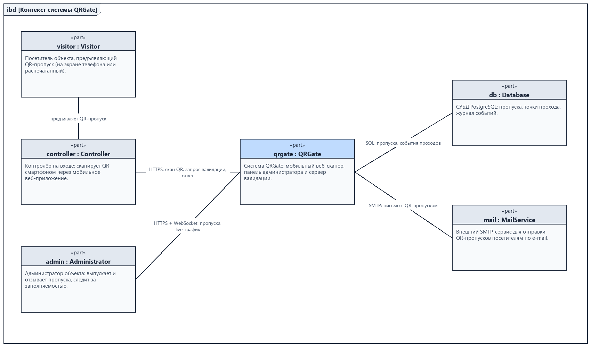
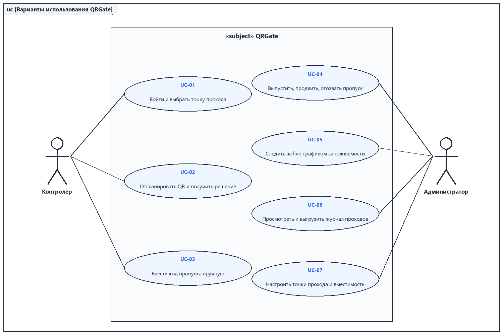
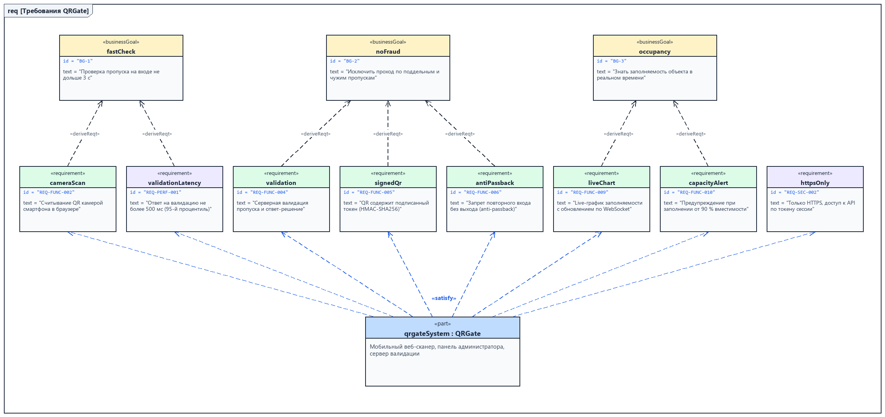
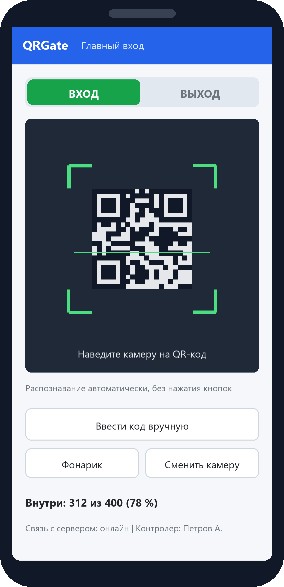
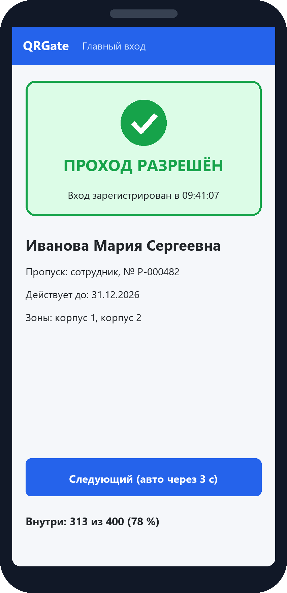
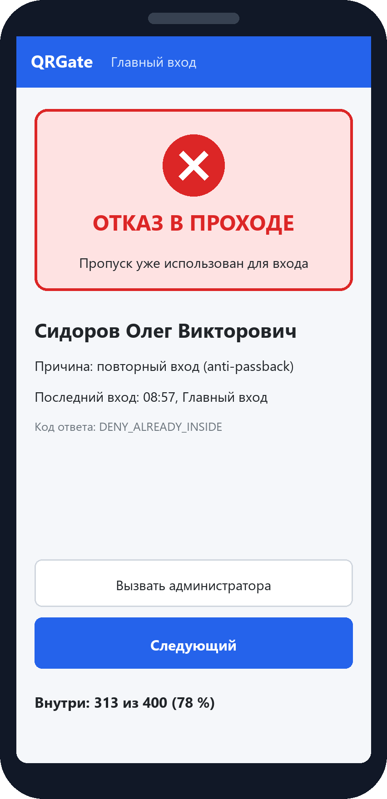
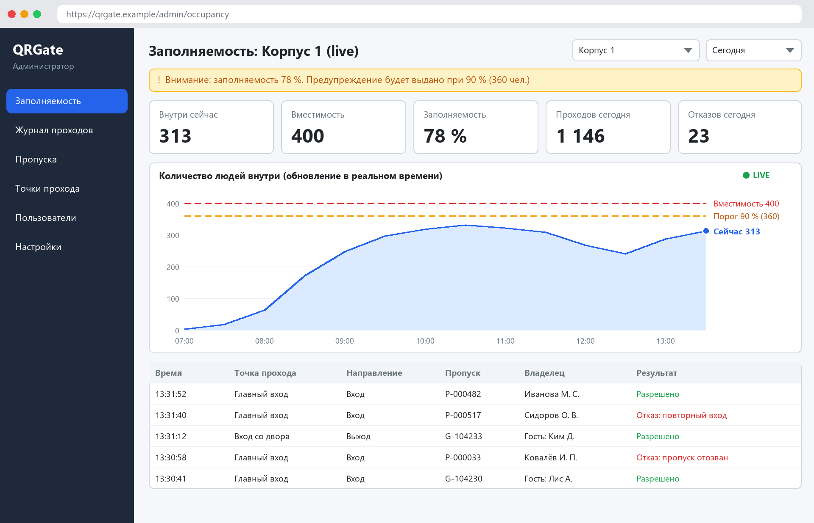

# Спецификация требований к ПО

Для QRGate — системы контроля доступа по QR-пропускам

Версия 0.3

Подготовил Гамза Григорий Александрович, группа 439401

БГУИР, кафедра ЭВМ

29.10.2026

## Оглавление

<!-- TOC -->
* [1. Введение](#1-introduction)
  * [1.1 Назначение документа](#11-document-purpose)
  * [1.2 Область применения продукта](#12-product-scope)
  * [1.3 Определения, акронимы и сокращения](#13-definitions-acronyms-and-abbreviations)
  * [1.4 Ссылки](#14-references)
  * [1.5 Обзор документа](#15-document-overview)
* [2. Обзор продукта](#2-product-overview)
  * [2.1 Перспектива продукта](#21-product-perspective)
  * [2.2 Функции продукта](#22-product-functions)
  * [2.3 Ограничения продукта](#23-product-constraints)
  * [2.4 Характеристики пользователей](#24-user-characteristics)
  * [2.5 Допущения и зависимости](#25-assumptions-and-dependencies)
  * [2.6 Распределение требований](#26-apportioning-of-requirements)
* [3. Требования](#3-requirements)
  * [3.1 Внешние интерфейсы](#31-external-interfaces)
    * [3.1.1 Пользовательские интерфейсы](#311-user-interfaces)
    * [3.1.2 Аппаратные интерфейсы](#312-hardware-interfaces)
    * [3.1.3 Программные интерфейсы](#313-software-interfaces)
  * [3.2 Функциональные требования](#32-functional)
  * [3.3 Качество обслуживания](#33-quality-of-service)
    * [3.3.1 Производительность](#331-performance)
    * [3.3.2 Безопасность](#332-security)
    * [3.3.3 Надёжность](#333-reliability)
    * [3.3.4 Доступность](#334-availability)
    * [3.3.5 Наблюдаемость](#335-observability)
  * [3.4 Соответствие стандартам](#34-compliance)
  * [3.5 Проектирование и реализация](#35-design-and-implementation)
    * [3.5.1 Установка](#351-installation)
    * [3.5.2 Сборка и поставка](#352-build-and-delivery)
    * [3.5.3 Распределение](#353-distribution)
    * [3.5.4 Сопровождаемость](#354-maintainability)
    * [3.5.5 Повторное использование](#355-reusability)
    * [3.5.6 Переносимость](#356-portability)
    * [3.5.7 Стоимость](#357-cost)
    * [3.5.8 Сроки](#358-deadline)
    * [3.5.9 Доказательство концепции](#359-proof-of-concept)
    * [3.5.10 Управление изменениями](#3510-change-management)
  * [3.6 ИИ/МО](#36-aiml)
* [4. Верификация](#4-verification)
* [5. Приложения](#5-appendixes)
<!-- TOC -->

## История изменений

| Name | Date | Reason For Changes | Version |
|------|------|--------------------|---------|
| Гамза Г. А. | 25.10.2026 | Первая редакция по итогам интервью с заказчиком | 0.1 |
| Гамза Г. А. | 27.10.2026 | Приоритеты функционала (10–50) и функции бэклога в 2.6; live-график в релизах 1–2 — только за сутки, история за 7 дней — релиз 3; сроки 3.5.8 по плану v2 | 0.2 |
| Гамза Г. А. | 29.10.2026 | Второй раунд с заказчиком: добавлены REQ-FUNC-014 (список эвакуации) и REQ-FUNC-015 (фото владельца), REQ-SEC-005 заменено на REQ-SEC-005-2, REQ-INT-007 (e-mail) перенесено в релиз 3; сроки по плану v3 | 0.3 |

---

## 1. Введение {#1-introduction}

Документ описывает требования к системе QRGate — веб-системе контроля доступа на объект по QR-пропускам. Контролёр сканирует QR-код камерой смартфона в мобильном веб-приложении, сервер проверяет пропуск и возвращает решение, а администратор в реальном времени видит график заполняемости объекта. Раздел 1 задаёт рамки документа, раздел 2 — контекст продукта, раздел 3 — проверяемые требования, раздел 4 — способы их верификации.

### 1.1 Назначение документа {#11-document-purpose}

SRS фиксирует, **что** должна делать система QRGate, и служит соглашением между заказчиком и командой разработки. Документ используют: заказчик — для согласования объёма работ; разработчики — как исходные данные для проектирования (SDD) и реализации; тестировщики — для построения тестов по матрице раздела 4; преподаватель — для контроля хода курсового проекта по дисциплине ЖЦРПО. Связанные артефакты: модели SysML v2 в каталоге [`srs/models`](models) и изображения в [`srs/img`](img).

### 1.2 Область применения продукта {#12-product-scope}

Продукт: **QRGate**, релиз 1.0 (MVP).

QRGate заменяет визуальную проверку бумажных пропусков и журналов на входе в учебный корпус, офис или площадку мероприятия. Бизнес-цели заказчика:

| ID | Бизнес-цель | Мера успеха |
|----|-------------|-------------|
| BG-1 | Ускорить проход через пост контроля | Проверка одного пропуска не дольше 3 с от наведения камеры до решения |
| BG-2 | Исключить проход по поддельным, просроченным и чужим пропускам | 0 случаев прохода по недействительному пропуску на приёмочных испытаниях |
| BG-3 | Знать заполняемость объекта в реальном времени | Администратор видит актуальное число людей внутри с задержкой не более 2 с |

**Входит в рамки:** мобильное веб-приложение сканера; сервер валидации пропусков; панель администратора с live-графиком заполняемости, журналом проходов и управлением пропусками; список находящихся внутри для эвакуации; фото владельца на карточке результата.

**Не входит в рамки релизов 1.0–2.0:** отправка QR-пропусков по e-mail (перенесена в релиз 3 по решению заказчика от 28.10.2026); история заполняемости за 7 дней (релиз 3); управление турникетами и замками; распознавание лиц; оплата пропусков; нативные мобильные приложения из App Store / Google Play; интеграция с кадровыми системами (рассматривается для релиза 3).

Границы системы показаны на контекстной диаграмме (рисунок 1).



*Рисунок 1 – Контекстная диаграмма (SysML v2, [`models/qrgate-context.sysml`](models/qrgate-context.sysml))*

### 1.3 Определения, акронимы и сокращения {#13-definitions-acronyms-and-abbreviations}

| Term | Definition |
|------|------------|
| Anti-passback | Правило, запрещающее повторный вход по пропуску, пока не зарегистрирован выход |
| API | Application Programming Interface — набор определений и протоколов для создания и интеграции прикладного ПО |
| HMAC-SHA256 | Код аутентификации сообщения на основе хеш-функции SHA-256 и секретного ключа |
| PWA | Progressive Web App — веб-приложение, которое можно установить на главный экран смартфона |
| QR-код | Двумерный штрихкод по ISO/IEC 18004 |
| SRS | Software Requirements Specification — документ, описывающий назначение, требования и характер ПО |
| UI | User Interface — визуальная часть приложения, через которую пользователь взаимодействует с ПО |
| WebSocket | Протокол двунаправленной связи браузера с сервером (RFC 6455) |
| Валидация | Серверная проверка пропуска с решением «разрешить» или «отказать» и кодом причины |
| Вместимость | Максимально допустимое число людей одновременно внутри объекта |
| Заполняемость | Отношение числа людей внутри объекта к вместимости, в процентах |
| Контролёр | Сотрудник на посту контроля, сканирующий пропуска |
| Пропуск | Запись о праве прохода: владелец, тип, срок действия, зоны, статус |
| Точка прохода | Вход или выход объекта, на котором работает контролёр |

### 1.4 Ссылки {#14-references}

| Документ | Версия / дата | Расположение | Статус |
|----------|---------------|--------------|--------|
| ISO/IEC/IEEE 29148:2018. Requirements engineering | 2018 | iso.org | Нормативная |
| ISO/IEC 18004:2015. QR Code bar code symbology specification | 2015 | iso.org | Нормативная |
| WCAG 2.1 | 05.06.2018 | w3.org/TR/WCAG21 | Нормативная (уровень AA) |
| RFC 6455. The WebSocket Protocol | 2011 | rfc-editor.org | Справочная |
| RFC 2104. HMAC | 1997 | rfc-editor.org | Справочная |
| Закон Республики Беларусь от 07.05.2021 № 99-З «О защите персональных данных» | 2021 | pravo.by | Нормативная |
| OMG SysML v2 Specification | 2.0 | omg.org | Справочная |
| Шаблон SRS кафедры ЭВМ | — | [`srs-template.md`](srs-template.md) | Нормативная |
| Модели SysML v2 проекта | 0.1 | [`models/`](models) | Справочная |

### 1.5 Обзор документа {#15-document-overview}

Раздел 2 описывает продукт в целом: окружение, функции, ограничения, пользователей и допущения. Раздел 3 содержит требования с уникальными идентификаторами `REQ-[AREA]-[NNN]`; ключевые слова «должна» — обязательно, «следует» — желательно, «может» — по усмотрению. Раздел 4 содержит матрицу верификации. Раздел 5 — приложения: исходные бизнес-требования заказчика и макеты интерфейса. Изменения вносятся через pull request в репозиторий и фиксируются в таблице «История изменений».

---

## 2. Обзор продукта {#2-product-overview}

### 2.1 Перспектива продукта {#21-product-perspective}

QRGate — новый самостоятельный продукт, разрабатываемый как курсовой проект по дисциплине ЖЦРПО. Система состоит из трёх частей:

1. **Сканер** — мобильное веб-приложение (PWA), открываемое в браузере смартфона контролёра.
2. **Панель администратора** — веб-приложение для настольного браузера.
3. **Сервер** — REST API валидации и управления, WebSocket-канал событий, база данных PostgreSQL.

Внешние зависимости: SMTP-сервис для отправки пропусков по e-mail. Владелец продукта — заказчик (администрация объекта); разработка и сопровождение — автор документа.

### 2.2 Функции продукта {#22-product-functions}

- **Вход контролёра** и выбор точки прохода и направления (вход/выход).
- **Сканирование QR** камерой смартфона без установки приложений, ручной ввод кода как запасной вариант.
- **Валидация пропуска** на сервере: подпись, срок, статус, зона, anti-passback, вместимость.
- **Отображение решения** крупной цветной карточкой со звуком и вибрацией.
- **Учёт заполняемости**: счётчик людей внутри по событиям входа и выхода.
- **Live-график заполняемости** на панели администратора с порогом предупреждения.
- **Управление пропусками**: выпуск, продление, отзыв, импорт из CSV, скачивание QR, фото владельца.
- **Список эвакуации**: кто сейчас внутри объекта — в панели (с печатью) и на сканере.
- **Журнал проходов** с фильтрами и выгрузкой в CSV.
- **Настройка** точек прохода, зон, вместимости и порога предупреждения.



*Рисунок 2 – Диаграмма вариантов использования (SysML v2, [`models/qrgate-usecases.sysml`](models/qrgate-usecases.sysml))*

### 2.3 Ограничения продукта {#23-product-constraints}

| ID | Ограничение | Тип |
|----|-------------|-----|
| CON-1 | Сканер должен работать в браузере смартфона без установки нативного приложения | Внешнее, обязательное (заказчик) |
| CON-2 | Клиентская часть должна быть написана на TypeScript (React), серверная — на TypeScript (Node.js 20 LTS, Express), СУБД — PostgreSQL 16 | Внутреннее, обязательное |
| CON-3 | Вся связь клиентов с сервером должна идти только по HTTPS/WSS (камера в браузере доступна только в безопасном контексте) | Внешнее, обязательное |
| CON-4 | Должны использоваться только бесплатные библиотеки с открытой лицензией (MIT, Apache 2.0, BSD) | Внутреннее, обязательное |
| CON-5 | Обработка персональных данных должна соответствовать Закону РБ № 99-З | Внешнее, обязательное |
| CON-6 | Интерфейс должен быть на русском языке | Внешнее, обязательное |

### 2.4 Характеристики пользователей {#24-user-characteristics}

| Класс | Цели | Подготовка | Частота | Доступ |
|-------|------|------------|---------|--------|
| Контролёр | Быстро пропускать людей, не ошибаться | Базовые навыки работы со смартфоном, обучение не более 10 минут | Каждая смена, до 600 сканов в час в пиковое время | Только сканер своей точки прохода |
| Администратор | Выпускать пропуска, следить за заполняемостью, разбирать инциденты | Уверенный пользователь ПК | Ежедневно | Панель администратора, все данные объекта |
| Посетитель | Пройти на объект | Не требуется | Ежедневно или разово | Не работает с системой, только предъявляет QR |

Условия работы контролёра: улица или вестибюль, яркое солнце или слабое освещение, иногда перчатки — поэтому кнопки сканера крупные, а результат дублируется цветом, текстом, звуком и вибрацией.

### 2.5 Допущения и зависимости {#25-assumptions-and-dependencies}

| ID | Допущение / зависимость | Влияние, если неверно |
|----|-------------------------|-----------------------|
| AS-1 | На посту есть стабильный мобильный интернет или Wi-Fi | Проход блокируется (REQ-REL-001); нужен резервный канал или офлайн-режим |
| AS-2 | Смартфоны контролёров: Android 10+ с Chrome 100+ или iOS 16+ с Safari, камера с автофокусом | Сканирование может быть медленным или невозможным |
| AS-3 | Посетители предъявляют QR на экране телефона с яркостью не ниже 50 % или на бумаге | Растёт число ручных вводов кода |
| AS-4 | Заказчик предоставляет сервер (VPS) с Docker и доменное имя с TLS-сертификатом | Развёртывание откладывается |
| AS-5 | Библиотека ZXing (`@zxing/browser`) поддерживается и доступна | Использовать альтернативу (jsQR) |

### 2.6 Распределение требований {#26-apportioning-of-requirements}

Приоритет — от 10 (наивысший) до 50 (минимальный), шкала и оценки — в бэклоге [`docs/plan/backlog.md`](../docs/plan/backlog.md); итерации — по согласованному плану [`plan-v3.md`](../docs/plan/plan-v3.md).

| Требование | Функция бэклога | Priority | Сканер | Панель | Сервер | Релиз |
|------------|-----------------|---------:|:------:|:------:|:------:|:-----:|
| REQ-FUNC-001 Вход контролёра | F02 Auth & Roles | 10 | ● | | ● | 1 |
| REQ-FUNC-002 Сканирование QR | F05 Camera QR Scanning | 10 | ● | | | 1 |
| REQ-FUNC-003 Ручной ввод кода | F07 Manual Code Entry | 20 | ● | | ● | 1 |
| REQ-FUNC-004 Валидация | F04 Validation Engine | 10 | | | ● | 1 |
| REQ-FUNC-005 Подписанный QR | F03 Signed QR Token | 10 | | | ● | 1 |
| REQ-FUNC-006 Anti-passback | F04 Validation Engine | 10 | | | ● | 1 |
| REQ-FUNC-007 Отображение решения | F06 Result Screen | 10 | ● | | | 1 |
| REQ-FUNC-008 Управление пропусками | F08 Pass Management, F10 CSV Import | 10, 20 | | ● | ● | 1 |
| REQ-FUNC-009 Live-график (за сутки) | F11 Live Occupancy Chart | 20 | | ● | ● | 1 |
| REQ-FUNC-009 Live-график (вчера, 7 дней, догрузка) | F20 Occupancy History & Backfill | 50 | | ● | ● | 3 (отложено) |
| REQ-FUNC-010 Предупреждение о заполнении | F12 Capacity Warning & Lock | 20 | ● | ● | ● | 1 |
| REQ-FUNC-011 Журнал проходов | F13 Access Log | 20 | | ● | ● | 2 |
| REQ-FUNC-012 Настройка объекта | F14 Site Configuration | 20 | | ● | ● | 1 |
| REQ-FUNC-013 Сброс счётчика | F15 Counter Reset | 40 | | ● | ● | 2 |
| REQ-FUNC-014 Список эвакуации | F21 Evacuation List | 10 | ● | ● | ● | 1 |
| REQ-FUNC-015 Фото владельца | F22 Holder Photo | 20 | ● | ● | ● | 2 |
| REQ-INT-007 Отправка по e-mail | F09 Pass E-mail Delivery | — | | | ● | 3 (отложено) |
| REQ-OBS-001 Журналы и метрики | F16 Observability | 40 | | | ● | 2 |
| REQ-SEC-005-2 Персональные данные | F17 PD Retention | 40 | | ● | ● | 2 |
| REQ-PERF-001 – 003 | F18 Load Testing & Hardening | 30 | | | ● | 2 |
| REQ-INST-002 PWA | F19 PWA Install | 50 | ● | | | 1 |
| Интеграция с турникетами | — | — | | | ● | 3 (отложено) |
| Офлайн-режим сканера | — | — | ● | | ● | 3 (отложено) |

---

## 3. Требования {#3-requirements}

Все требования оформлены по шаблону: **ID**, **Title**, **Statement**, **Rationale**, **Acceptance Criteria**, **Verification Method**. Связь требований с бизнес-целями показана на рисунке 3.



*Рисунок 3 – Диаграмма требований (SysML v2, [`models/qrgate-requirements.sysml`](models/qrgate-requirements.sysml))*

### 3.1 Внешние интерфейсы {#31-external-interfaces}

#### 3.1.1 Пользовательские интерфейсы {#311-user-interfaces}

Макеты экранов приведены в приложении Б (рисунки Б.1–Б.4) и построены из модели [`models/qrgate-ui.sysml`](models/qrgate-ui.sysml).

- **ID:** REQ-INT-001
- **Title:** Мобильный интерфейс сканера
- **Statement:** Сканер должен корректно отображаться на экранах шириной от 360 до 430 пикселей CSS в портретной ориентации; все кнопки должны иметь высоту не менее 48 пикселей CSS; окно камеры должно занимать не менее 45 % высоты экрана.
- **Rationale:** Контролёр работает одной рукой, иногда в перчатках (раздел 2.4).
- **Acceptance Criteria:** На Chrome DevTools с профилями 360×800 и 430×932 нет горизонтальной прокрутки, нет перекрытия элементов, размеры кнопок соответствуют требованию.
- **Verification Method:** Inspection

- **ID:** REQ-INT-002
- **Title:** Результат проверки различим без чтения текста
- **Statement:** Решение должно показываться полноэкранной карточкой: зелёной с галочкой и текстом «ПРОХОД РАЗРЕШЁН» или красной с крестом и текстом «ОТКАЗ В ПРОХОДЕ»; сопровождаться звуком (разный тон для разрешения и отказа) и вибрацией 200 мс при отказе.
- **Rationale:** Контролёр должен понять решение за доли секунды, не вчитываясь (BG-1); цвет дублируется формой значка для людей с нарушением цветовосприятия.
- **Acceptance Criteria:** Контраст текста карточки к фону не ниже 4.5:1; значки различимы в оттенках серого.
- **Verification Method:** Inspection, Demonstration

- **ID:** REQ-INT-003
- **Title:** Панель администратора
- **Statement:** Панель должна быть рассчитана на ширину экрана от 1280 пикселей и содержать: меню разделов, карточки показателей (внутри сейчас, вместимость, заполняемость, проходов и отказов за день), live-график и ленту последних событий.
- **Rationale:** Администратор следит за объектом с рабочего компьютера (BG-3).
- **Acceptance Criteria:** Все перечисленные элементы видны на экране 1280×720 без прокрутки, кроме ленты событий.
- **Verification Method:** Inspection

#### 3.1.2 Аппаратные интерфейсы {#312-hardware-interfaces}

- **ID:** REQ-INT-004
- **Title:** Камера смартфона
- **Statement:** Сканер должен получать видеопоток через `navigator.mediaDevices.getUserMedia` с предпочтением основной (задней) камеры, разрешением не менее 1280×720, и позволять переключить камеру и включить фонарик, если устройство это поддерживает.
- **Rationale:** Без доступа к камере функция сканирования невозможна (CON-1).
- **Acceptance Criteria:** На трёх тестовых устройствах (см. 3.5.9) камера запускается не дольше 2 с после разрешения доступа.
- **Verification Method:** Demonstration

Управление турникетами, замками и считывателями карт в релиз 1.0 не входит.

#### 3.1.3 Программные интерфейсы {#313-software-interfaces}

- **ID:** REQ-INT-005
- **Title:** REST API валидации
- **Statement:** Сервер должен предоставлять `POST /api/v1/validate` с телом `{ "token": string, "checkpointId": string, "direction": "IN" | "OUT" }` и отвечать `{ "decision": "ALLOW" | "DENY", "reason": string, "pass": { "id", "holder", "type", "validTo" } | null, "occupancy": { "inside": number, "capacity": number } }`. Коды причин: `OK`, `DENY_BAD_SIGNATURE`, `DENY_NOT_FOUND`, `DENY_EXPIRED`, `DENY_REVOKED`, `DENY_ZONE`, `DENY_ALREADY_INSIDE`, `DENY_NOT_INSIDE`, `DENY_CAPACITY`.
- **Rationale:** Единый контракт между сканером и сервером.
- **Acceptance Criteria:** Контракт описан в OpenAPI 3.1 (`docs/api/openapi.yaml`); контрактные тесты проходят для каждого кода причины.
- **Verification Method:** Test

- **ID:** REQ-INT-006
- **Title:** WebSocket-канал заполняемости
- **Statement:** Сервер должен рассылать по `wss://<host>/ws/occupancy` сообщение `{ "type": "occupancy", "objectId", "inside", "capacity", "ts" }` после каждого изменения счётчика и сообщение `{ "type": "event", ... }` о каждом проходе или отказе.
- **Rationale:** Live-график и лента событий без опроса сервера (BG-3).
- **Acceptance Criteria:** Подписанный клиент получает сообщение не позже 1 с после ответа на `/validate`.
- **Verification Method:** Test

- **ID:** REQ-INT-007
- **Title:** Отправка пропусков по e-mail *(релиз 3; исключено из релизов 1–2 по решению заказчика от 28.10.2026)*
- **Statement:** Сервер должен отправлять письмо с QR-кодом в формате PNG через SMTP с TLS; параметры SMTP задаются переменными окружения.
- **Rationale:** Посетители получают пропуск без участия администратора.
- **Acceptance Criteria:** Письмо доставляется в тестовый ящик (MailHog в окружении разработки) с вложением, QR из которого успешно проходит валидацию.
- **Verification Method:** Test

### 3.2 Функциональные требования {#32-functional}

**Сканер (UC-01–UC-03)**

- **ID:** REQ-FUNC-001
- **Title:** Вход контролёра и выбор точки прохода
- **Statement:** Сканер должен требовать вход по логину и паролю, после чего контролёр выбирает точку прохода из списка разрешённых ему; сессия действует 12 часов.
- **Rationale:** Каждое событие привязывается к контролёру и точке прохода; посторонний не может пользоваться сканером.
- **Acceptance Criteria:** Без входа запрос к `/validate` возвращает 401; после 12 ч требуется повторный вход.
- **Verification Method:** Test

- **ID:** REQ-FUNC-002
- **Title:** Считывание QR камерой
- **Statement:** Сканер должен непрерывно анализировать видеопоток не реже 10 кадров в секунду и автоматически, без нажатия кнопок, отправлять запрос валидации при распознавании QR-кода; повторное распознавание того же кода в течение 3 с игнорируется.
- **Rationale:** Скорость прохода (BG-1); защита от двойной отправки, пока код остаётся в кадре.
- **Acceptance Criteria:** QR размером 3×3 см с расстояния 15–40 см распознаётся не дольше 1 с в 95 % попыток при освещённости от 50 лк.
- **Verification Method:** Test, Demonstration

- **ID:** REQ-FUNC-003
- **Title:** Ручной ввод кода
- **Statement:** Сканер должен позволять ввести номер пропуска вручную (формат `P-NNNNNN` для сотрудников, `G-NNNNNN` для гостей); такое событие помечается в журнале как «ручной ввод».
- **Rationale:** Повреждённый QR, разбитый экран телефона посетителя.
- **Acceptance Criteria:** Некорректный формат подсвечивается до отправки; событие в журнале имеет признак `manual = true`.
- **Verification Method:** Test

**Сервер (UC-02)**

- **ID:** REQ-FUNC-004
- **Title:** Валидация пропуска
- **Statement:** Сервер должен принимать решение ALLOW только при одновременном выполнении условий: подпись токена верна; пропуск существует и не отозван; текущее время в пределах срока действия; точка прохода входит в зоны пропуска; соблюдено правило anti-passback (REQ-FUNC-006); при входе число людей внутри меньше вместимости, если включена блокировка по вместимости. Иначе — DENY с кодом первой нарушенной проверки в указанном порядке. Каждое решение записывается в журнал.
- **Rationale:** Главная бизнес-цель BG-2.
- **Acceptance Criteria:** Набор тестов покрывает каждый код причины из REQ-INT-005; ни один недействительный пропуск не получает ALLOW.
- **Verification Method:** Test

- **ID:** REQ-FUNC-005
- **Title:** Подписанный QR-токен
- **Statement:** QR-код должен содержать только токен вида `base64url(passId.version).base64url(HMAC-SHA256(secret, passId.version))`, без персональных данных. При отзыве или перевыпуске пропуска `version` увеличивается, и старые QR-коды становятся недействительными.
- **Rationale:** Подделка QR без секретного ключа невозможна (BG-2); утечка QR не раскрывает данные владельца (CON-5).
- **Acceptance Criteria:** Изменение любого символа токена приводит к `DENY_BAD_SIGNATURE`; после перевыпуска старый QR получает `DENY_REVOKED`.
- **Verification Method:** Test

- **ID:** REQ-FUNC-006
- **Title:** Anti-passback
- **Statement:** Сервер должен отказывать во входе по пропуску, владелец которого уже числится внутри объекта (`DENY_ALREADY_INSIDE`), и в выходе тому, кто не числится внутри (`DENY_NOT_INSIDE`), если для объекта включён режим строгого anti-passback. Администратор может вручную сбросить состояние пропуска.
- **Rationale:** Нельзя передать свой пропуск другому человеку через забор или окно (BG-2); счётчик заполняемости остаётся точным (BG-3).
- **Acceptance Criteria:** Два подряд входа по одному пропуску: первый ALLOW, второй DENY_ALREADY_INSIDE; после выхода вход снова разрешён.
- **Verification Method:** Test

- **ID:** REQ-FUNC-007
- **Title:** Отображение решения
- **Statement:** Сканер должен показать результат по REQ-INT-002 вместе с ФИО владельца, типом и сроком действия пропуска (при ALLOW) или причиной отказа на русском языке (при DENY) и автоматически вернуться к сканированию через 3 с после ALLOW; после DENY возврат только по кнопке «Следующий».
- **Rationale:** Контролёр сверяет ФИО с документом при необходимости; отказ требует осознанного действия.
- **Acceptance Criteria:** Соответствие макетам рисунков Б.2 и Б.3.
- **Verification Method:** Demonstration

**Панель администратора (UC-04–UC-07)**

- **ID:** REQ-FUNC-008
- **Title:** Управление пропусками
- **Statement:** Администратор должен иметь возможность создать пропуск (ФИО, тип «сотрудник» или «гость», e-mail, срок действия, зоны), продлить, отозвать, перевыпустить, скачать QR в PNG, отправить QR по e-mail и импортировать пропуска из CSV (UTF-8, разделитель `;`).
- **Rationale:** Выпуск пропусков — источник данных для валидации.
- **Acceptance Criteria:** Импорт файла на 500 строк выполняется не дольше 10 с; строки с ошибками перечисляются в отчёте импорта и не прерывают загрузку остальных.
- **Verification Method:** Test

- **ID:** REQ-FUNC-009
- **Title:** Live-график заполняемости
- **Statement:** Панель должна показывать линейный график числа людей внутри выбранного объекта за выбранный период (сегодня, вчера, 7 дней) с горизонтальными линиями вместимости и порога предупреждения и обновлять последнюю точку и карточки показателей по сообщениям WebSocket без перезагрузки страницы.
- **Rationale:** Бизнес-цель BG-3.
- **Acceptance Criteria:** После прохода по пропуску значение на графике меняется не позже 2 с; при обрыве связи показывается индикатор «нет связи», после восстановления график догружает пропущенные данные.
- **Verification Method:** Test, Demonstration

- **ID:** REQ-FUNC-010
- **Title:** Предупреждение о заполнении
- **Statement:** При заполняемости не ниже порога (по умолчанию 90 %) панель должна показывать жёлтый баннер и подавать звуковой сигнал, а сканеры — показывать предупреждение; при 100 % поведение задаётся настройкой: только предупреждение или отказ во входе с кодом `DENY_CAPACITY`.
- **Rationale:** Требования пожарной безопасности ограничивают число людей в здании (BG-3).
- **Acceptance Criteria:** При 360 из 400 появляется баннер; при включённой блокировке 401-й вход получает DENY_CAPACITY, выход разрешён всегда.
- **Verification Method:** Test

- **ID:** REQ-FUNC-011
- **Title:** Журнал проходов
- **Statement:** Панель должна показывать журнал событий с фильтрами по периоду, точке прохода, пропуску, результату и выгружать отфильтрованные данные в CSV.
- **Rationale:** Разбор инцидентов, отчётность.
- **Acceptance Criteria:** Выборка за месяц (до 50 000 событий) открывается не дольше 3 с при постраничном выводе по 100 записей.
- **Verification Method:** Test

- **ID:** REQ-FUNC-012
- **Title:** Настройка объекта
- **Statement:** Администратор должен иметь возможность создавать объекты, точки прохода, зоны, задавать вместимость, порог предупреждения, режим anti-passback и режим блокировки по вместимости, а также учётные записи контролёров.
- **Rationale:** Система используется на разных объектах заказчика.
- **Acceptance Criteria:** Изменение вместимости сразу отражается на графике и в проверке REQ-FUNC-010.
- **Verification Method:** Demonstration

- **ID:** REQ-FUNC-013
- **Title:** Сброс счётчика
- **Statement:** Сервер должен ежедневно в 04:00 по времени объекта обнулять состояние «внутри» для всех пропусков; администратор может выполнить сброс вручную с указанием причины.
- **Rationale:** Люди, вышедшие без сканирования (например, через аварийный выход), не должны блокироваться anti-passback на следующий день.
- **Acceptance Criteria:** Каждый сброс фиксируется в журнале с автором и причиной.
- **Verification Method:** Test

- **ID:** REQ-FUNC-014
- **Title:** Список находящихся внутри (эвакуация)
- **Statement:** Система должна формировать список владельцев пропусков, находящихся внутри объекта (ФИО, тип пропуска, время и точка входа), с отбором по зоне: в панели администратора — с печатью и выгрузкой в PDF, на сканере — по кнопке «Кто внутри» для контролёров этого объекта.
- **Rationale:** Требование пожарной инспекции: при эвакуации сверить, все ли вышли (BG-3). Добавлено по запросу заказчика 28.10.2026.
- **Acceptance Criteria:** Список совпадает с состоянием «внутри» в БД; для 400 человек формируется не дольше 2 с; печатная версия умещает 40 строк на листе A4.
- **Verification Method:** Test, Demonstration

- **ID:** REQ-FUNC-015
- **Title:** Фото владельца на карточке результата
- **Statement:** Администратор должен иметь возможность загрузить фото владельца пропуска (JPEG или PNG до 5 МБ, кадрирование до квадрата, сжатие до 480×480) при наличии отметки о согласии на обработку; сканер должен показывать фото на карточке результата при решении ALLOW и DENY.
- **Rationale:** Контролёр сверяет лицо с фото, чтобы исключить проход по чужому QR (BG-2). Добавлено по запросу заказчика 28.10.2026.
- **Acceptance Criteria:** Фото появляется на карточке не позже 300 мс после решения при 4G; без согласия загрузка недоступна; без сессии фото недоступно (401).
- **Verification Method:** Test, Demonstration

### 3.3 Качество обслуживания {#33-quality-of-service}

#### 3.3.1 Производительность {#331-performance}

- **ID:** REQ-PERF-001
- **Title:** Время валидации на сервере
- **Statement:** Время обработки `/validate` на сервере должно быть не более 500 мс для 95 % запросов при нагрузке 20 запросов в секунду.
- **Rationale:** BG-1; пиковая нагрузка — 4 поста по 600 сканов в час с запасом.
- **Acceptance Criteria:** Нагрузочный тест k6 в течение 10 минут: p95 ≤ 500 мс, ошибок 0 %.
- **Verification Method:** Test

- **ID:** REQ-PERF-002
- **Title:** Время от скана до решения
- **Statement:** Время от распознавания QR до отображения решения на смартфоне должно быть не более 1,5 с в 95 % случаев при мобильном соединении 4G.
- **Rationale:** BG-1 (3 с на весь проход с учётом наведения камеры).
- **Acceptance Criteria:** Замер на 100 последовательных сканах.
- **Verification Method:** Test

- **ID:** REQ-PERF-003
- **Title:** Объём данных
- **Statement:** Система должна поддерживать до 10 000 активных пропусков, 50 одновременно работающих сканеров, 20 открытых панелей администратора и хранение 2 млн событий без снижения показателей REQ-PERF-001.
- **Rationale:** Крупнейший объект заказчика — 3 корпуса по 400 человек.
- **Acceptance Criteria:** Нагрузочный тест на заполненной тестовыми данными базе.
- **Verification Method:** Test

#### 3.3.2 Безопасность {#332-security}

- **ID:** REQ-SEC-001
- **Title:** Роли и доступ
- **Statement:** Система должна поддерживать роли «контролёр» и «администратор»; контролёр имеет доступ только к `/validate` для своих точек прохода и к счётчику своего объекта.
- **Rationale:** Принцип минимальных привилегий.
- **Acceptance Criteria:** Запрос контролёра к API администратора возвращает 403.
- **Verification Method:** Test

- **ID:** REQ-SEC-002
- **Title:** Только HTTPS
- **Statement:** Все интерфейсы должны быть доступны только по HTTPS (TLS 1.2+) и WSS; HTTP-запросы перенаправляются на HTTPS; включён заголовок HSTS; API требует токен сессии.
- **Rationale:** CON-3; защита персональных данных при передаче.
- **Acceptance Criteria:** Проверка SSL Labs — оценка не ниже A.
- **Verification Method:** Test

- **ID:** REQ-SEC-003
- **Title:** Хранение секретов и паролей
- **Statement:** Ключ HMAC и параметры SMTP должны храниться только в переменных окружения сервера; пароли пользователей — в виде хеша bcrypt (cost ≥ 12); после 5 неудачных попыток входа учётная запись блокируется на 15 минут.
- **Rationale:** BG-2; защита от подбора паролей.
- **Acceptance Criteria:** Секреты отсутствуют в репозитории (проверка gitleaks); тест блокировки после 5 попыток.
- **Verification Method:** Inspection, Test

- **ID:** REQ-SEC-004
- **Title:** Ограничение частоты запросов
- **Statement:** Сервер должен ограничивать `/validate` до 10 запросов в секунду на один сканер и отвечать 429 при превышении.
- **Rationale:** Защита от перебора токенов.
- **Acceptance Criteria:** Нагрузочный тест с одного сканера: 11-й запрос в секунду получает 429.
- **Verification Method:** Test

- **ID:** REQ-SEC-005-2
- **Title:** Персональные данные
- **Statement:** Система должна хранить о владельце пропуска только ФИО, e-mail, тип пропуска и, при наличии согласия, фото с датой согласия; события журнала старше 12 месяцев должны удаляться автоматически; администратор может удалить данные владельца, включая фото, по запросу. *(Изменено 29.10.2026: добавлено фото, REQ-FUNC-015.)*
- **Rationale:** CON-5, принцип минимизации данных.
- **Acceptance Criteria:** Проверка схемы БД; тест задачи очистки.
- **Verification Method:** Inspection, Test

#### 3.3.3 Надёжность {#333-reliability}

- **ID:** REQ-REL-001
- **Title:** Отказ при отсутствии связи (fail-closed)
- **Statement:** При недоступности сервера дольше 5 с сканер должен показать «Нет связи с сервером — проверка невозможна» и не показывать решение ALLOW.
- **Rationale:** Решение заказчика: безопасность важнее пропускной способности (см. приложение А).
- **Acceptance Criteria:** При отключённой сети сканер не выдаёт ALLOW ни в одном из 20 попыток.
- **Verification Method:** Test

- **ID:** REQ-REL-002
- **Title:** Целостность событий
- **Statement:** Решение по пропуску, запись события и изменение счётчика должны выполняться в одной транзакции БД.
- **Rationale:** Счётчик заполняемости не должен расходиться с журналом.
- **Acceptance Criteria:** После 10 000 параллельных валидаций счётчик равен разности входов и выходов в журнале.
- **Verification Method:** Test

- **ID:** REQ-REL-003
- **Title:** Переподключение WebSocket
- **Statement:** Панель должна автоматически переподключаться к WebSocket с экспоненциальной задержкой от 1 до 30 с.
- **Rationale:** Мобильные и офисные сети нестабильны.
- **Acceptance Criteria:** После перезапуска сервера панель восстанавливает обновления без действий пользователя.
- **Verification Method:** Test

#### 3.3.4 Доступность {#334-availability}

- **ID:** REQ-AVAIL-001
- **Title:** Время работы
- **Statement:** Система должна быть доступна не менее 99,5 % времени в часы работы объекта (07:00–22:00); плановые работы проводятся с 22:00 до 07:00.
- **Rationale:** Без системы проход невозможен (REQ-REL-001).
- **Acceptance Criteria:** Мониторинг доступности за месяц опытной эксплуатации.
- **Verification Method:** Analysis

#### 3.3.5 Наблюдаемость {#335-observability}

- **ID:** REQ-OBS-001
- **Title:** Журналы и метрики
- **Statement:** Сервер должен писать структурированные логи в JSON (время, уровень, requestId, точка прохода, код решения, длительность) без токенов и ФИО и отдавать метрики Prometheus: число валидаций по кодам решений, гистограмму длительности `/validate`, число WebSocket-подключений.
- **Rationale:** Контроль REQ-PERF-001 и разбор инцидентов.
- **Acceptance Criteria:** Метрики доступны по `/metrics`; поиск в логах по токену не находит записей.
- **Verification Method:** Inspection

### 3.4 Соответствие стандартам {#34-compliance}

- **ID:** REQ-COMP-001
- **Title:** Персональные данные
- **Statement:** Обработка персональных данных должна соответствовать Закону РБ № 99-З «О защите персональных данных» (CON-5); при выпуске пропуска фиксируется основание обработки.
- **Rationale:** Нормативное требование.
- **Acceptance Criteria:** Наличие политики обработки персональных данных, ссылки на неё в панели администратора и в письме с пропуском.
- **Verification Method:** Inspection

- **ID:** REQ-COMP-002
- **Title:** Формат QR-кода
- **Statement:** QR-коды должны соответствовать ISO/IEC 18004, уровень коррекции ошибок M, размер в PNG не менее 300×300 пикселей.
- **Rationale:** Совместимость со сканерами и устойчивость к загрязнению.
- **Acceptance Criteria:** Сгенерированные QR читаются стандартной камерой Android и iOS.
- **Verification Method:** Test

- **ID:** REQ-COMP-003
- **Title:** Доступность интерфейса
- **Statement:** Интерфейсы сканера и панели должны соответствовать WCAG 2.1 уровня AA по контрасту и размеру целей нажатия.
- **Rationale:** Работа в условиях плохой видимости, пользователи с нарушениями зрения.
- **Acceptance Criteria:** Аудит Lighthouse Accessibility не ниже 90 баллов.
- **Verification Method:** Test

### 3.5 Проектирование и реализация {#35-design-and-implementation}

#### 3.5.1 Установка {#351-installation}

- **ID:** REQ-INST-001
- **Title:** Развёртывание через Docker Compose
- **Statement:** Сервер, база данных и статические файлы клиентов должны разворачиваться одной командой `docker compose up -d` на Linux-сервере с Docker 24+; конфигурация задаётся файлом `.env` (пример — `.env.example`).
- **Rationale:** Простота установки у заказчика.
- **Acceptance Criteria:** Развёртывание на чистом сервере по инструкции из README занимает не более 15 минут.
- **Verification Method:** Demonstration

- **ID:** REQ-INST-002
- **Title:** Установка сканера на смартфон
- **Statement:** Сканер должен поддерживать установку на главный экран как PWA (manifest, service worker для кэширования статических файлов).
- **Rationale:** Контролёр открывает сканер одним касанием.
- **Acceptance Criteria:** Chrome на Android предлагает «Установить приложение».
- **Verification Method:** Demonstration

#### 3.5.2 Сборка и поставка {#352-build-and-delivery}

- **ID:** REQ-BUILD-001
- **Title:** Автоматическая сборка
- **Statement:** Каждый push в репозиторий должен запускать в GitHub Actions проверку линтером, тесты и сборку Docker-образов; зависимости фиксируются lock-файлом `package-lock.json`.
- **Rationale:** Воспроизводимость сборки, раннее обнаружение ошибок.
- **Acceptance Criteria:** Pull request нельзя слить в `main` при красной сборке.
- **Verification Method:** Inspection

#### 3.5.3 Распределение {#353-distribution}

Релиз 1.0 разворачивается на одном сервере на объект заказчика; клиенты подключаются через интернет. Горизонтальное масштабирование и георезервирование не требуются.

#### 3.5.4 Сопровождаемость {#354-maintainability}

- **ID:** REQ-MAINT-001
- **Title:** Качество кода
- **Statement:** Код должен быть на TypeScript в строгом режиме (`strict: true`), проходить ESLint без ошибок; модуль валидации должен быть покрыт модульными тестами не менее чем на 80 % строк.
- **Rationale:** Модуль валидации — ядро системы и источник наибольшего риска (BG-2).
- **Acceptance Criteria:** Отчёт покрытия в CI.
- **Verification Method:** Inspection

#### 3.5.5 Повторное использование {#355-reusability}

Модуль формирования и проверки подписанного токена (REQ-FUNC-005) следует выделить в отдельный пакет без зависимостей от Express и БД, чтобы использовать его в будущих интеграциях с турникетами.

#### 3.5.6 Переносимость {#356-portability}

Сервер работает в Docker на любом Linux x86-64 или ARM64. Сканер поддерживает Chrome 100+ (Android 10+) и Safari 16+ (iOS 16+); панель — последние две версии Chrome, Edge, Firefox и Safari. Internet Explorer и браузеры без `getUserMedia` не поддерживаются.

#### 3.5.7 Стоимость {#357-cost}

Используются только бесплатные компоненты с открытой лицензией (CON-4). Эксплуатационные расходы — VPS не дороже 15 USD в месяц и домен; TLS-сертификат — Let's Encrypt.

#### 3.5.8 Сроки {#358-deadline}

Сроки согласованы с заказчиком 29.10.2026 (план v3, [`docs/plan/plan-v3.md`](../docs/plan/plan-v3.md)). Итерация — 2 недели; команда — middle-разработчик и junior-разработчик (с итерации I2).

| Итерация | Даты | Результат |
|----------|------|-----------|
| I1 | 02.11 – 13.11.2026 | Каркас и CI, вход, подписанный QR, сканер (POC на трёх устройствах) |
| I2 | 16.11 – 27.11.2026 | Валидация, экран результата, ручной ввод, пропуска, PWA |
| I3 | 30.11 – 11.12.2026 | Список эвакуации, live-график, предупреждение, импорт CSV, настройка — **релиз 1.0** |
| I4 | 14.12 – 25.12.2026 | Фото владельца, журнал, нагрузочный тест, сброс, метрики, персональные данные — **релиз 2.0** |

#### 3.5.9 Доказательство концепции {#359-proof-of-concept}

- **ID:** REQ-POC-001
- **Title:** Сканирование в браузере
- **Statement:** До начала разработки релиза 1 должен быть проверен прототип, распознающий QR камерой в браузере на трёх устройствах (бюджетный Android, флагманский Android, iPhone).
- **Rationale:** Главный технический риск — скорость и стабильность сканирования в браузере (AS-2, AS-5).
- **Acceptance Criteria:** REQ-FUNC-002 выполняется на всех трёх устройствах; при неуспехе решение пересматривается в ADR.
- **Verification Method:** Demonstration

#### 3.5.10 Управление изменениями {#3510-change-management}

Изменения требований вносятся через pull request в ветку `main` после ревью заказчиком (напарником) и преподавателем; каждое изменение увеличивает версию документа и фиксируется в истории изменений. Изменённое требование получает суффикс версии (`REQ-FUNC-004-2`). Версии продукта нумеруются по Semantic Versioning; изменения API валидации, ломающие совместимость, допускаются только с увеличением мажорной версии (`/api/v2`).

### 3.6 ИИ/МО {#36-aiml}

Система не содержит компонентов искусственного интеллекта и машинного обучения. Подразделы 3.6.1–3.6.6 не применимы.

---

## 4. Верификация {#4-verification}

| Requirement ID | Verification Method | Test/Artifact Link | Status | Evidence |
|----------------|---------------------|--------------------|--------|----------|
| REQ-INT-001 | Inspection | tests/ui/scanner-layout.md | Planned | |
| REQ-INT-002 | Inspection, Demonstration | tests/ui/result-card.md | Planned | |
| REQ-INT-005 | Test | tests/api/validate.contract.test.ts | Planned | |
| REQ-INT-006 | Test | tests/api/ws-occupancy.test.ts | Planned | |
| REQ-FUNC-001 | Test | tests/api/auth.test.ts | Planned | |
| REQ-FUNC-002 | Test, Demonstration | tests/e2e/scan.md | Planned | |
| REQ-FUNC-004 | Test | tests/unit/validation.test.ts | Planned | |
| REQ-FUNC-005 | Test | tests/unit/token.test.ts | Planned | |
| REQ-FUNC-006 | Test | tests/unit/antipassback.test.ts | Planned | |
| REQ-FUNC-009 | Test, Demonstration | tests/e2e/live-chart.md | Planned | |
| REQ-FUNC-010 | Test | tests/unit/capacity.test.ts | Planned | |
| REQ-PERF-001 | Test | tests/load/validate.k6.js | Planned | |
| REQ-SEC-002 | Test | SSL Labs report | Planned | |
| REQ-SEC-003 | Inspection, Test | CI: gitleaks | Planned | |
| REQ-REL-001 | Test | tests/e2e/offline.md | Planned | |
| REQ-REL-002 | Test | tests/integration/concurrency.test.ts | Planned | |
| REQ-FUNC-014 | Test, Demonstration | tests/api/inside.test.ts | Planned | |
| REQ-FUNC-015 | Test, Demonstration | tests/api/photos.test.ts | Planned | |
| REQ-SEC-005-2 | Inspection, Test | tests/unit/retention.test.ts | Planned | |
| REQ-POC-001 | Demonstration | docs/poc/scanner-poc.md | Planned | |

Тесты пишутся как позитивные, так и негативные: для REQ-FUNC-004 на каждый код отказа есть отдельный тест. Нефункциональные требования проверяются нагрузочными тестами k6 и аудитом Lighthouse.

---

## 5. Приложения {#5-appendixes}

### Приложение А. Бизнес-требования заказчика

Получены 25.10.2026 на интервью с заказчиком (роль заказчика — напарник по лабораторной работе).

| № | Вопрос менеджера проекта | Ответ заказчика | Отражено в |
|---|--------------------------|-----------------|------------|
| 1 | Какую проблему решает система? | На входе в корпус охранник проверяет бумажные пропуска на глаз, в час пик очередь, бывают проходы по чужим пропускам | BG-1, BG-2 |
| 2 | Кто будет пользоваться системой? | Охранники на входе и администратор здания; посетители только показывают QR | 2.4 |
| 3 | Какое оборудование есть у охраны? | Обычные смартфоны, специальные сканеры покупать не хотим | CON-1, REQ-INT-004 |
| 4 | Что важнее при пропадании интернета: пропустить или не пропустить? | Не пропускать, вызывать администратора | REQ-REL-001 |
| 5 | Зачем нужен график заполняемости? | По нормам пожарной безопасности в корпусе не больше 400 человек, нужно видеть, сколько людей внутри, и получать предупреждение заранее | BG-3, REQ-FUNC-009, REQ-FUNC-010 |
| 6 | Что делать, когда объект заполнен? | Сначала просто предупреждать; возможность запрещать вход нужна как настройка | REQ-FUNC-010 |
| 7 | Как посетители получают пропуска? | Сотрудникам — постоянный пропуск, гостям — разовый на день, удобно по e-mail | REQ-FUNC-008, REQ-INT-007 |
| 8 | Нужна ли связь с турникетами? | Пока нет, возможно позже | 1.2, 2.6 (релиз 3) |
| 9 | Сколько человек и постов? | До 3 корпусов по 400 человек, до 4 постов на корпус | REQ-PERF-003 |
| 10 | Нужны ли отчёты? | Журнал проходов с выгрузкой в Excel | REQ-FUNC-011 |

### Приложение Б. Макеты пользовательского интерфейса

Макеты описаны в модели [`models/qrgate-ui.sysml`](models/qrgate-ui.sysml) и преобразованы в PNG скриптом [`tools/sysml_render.py`](../tools/sysml_render.py):

```
python tools/sysml_render.py
```



*Рисунок Б.1 – Экран сканера (UC-02, UC-03)*



*Рисунок Б.2 – Результат проверки: проход разрешён*



*Рисунок Б.3 – Результат проверки: отказ в проходе*



*Рисунок Б.4 – Панель администратора с live-графиком заполняемости (UC-05, UC-06)*

### Приложение В. Изменения по итогам согласования плана

Переписка с заказчиком — [`docs/plan/correspondence.md`](../docs/plan/correspondence.md).

| Дата | Изменение | Причина | Отражено в |
|------|-----------|---------|------------|
| 27.10.2026 | Live-график в релизах 1–2 только за текущие сутки | Сокращение F11 с 32 до 20 ч | 2.6, ADR-0005 |
| 27.10.2026 | Приоритеты: импорт CSV и журнал 30 → 20, e-mail 30 → 40 | Решение заказчика | 2.6 |
| 28.10.2026 | Отправка пропусков по e-mail исключена из релизов 1–2 | Гостям пропуск печатает секретарь | 1.2, REQ-INT-007 |
| 28.10.2026 | Добавлен список эвакуации | Требование пожарной инспекции | REQ-FUNC-014 |
| 28.10.2026 | Добавлено фото владельца | Проход по чужому QR | REQ-FUNC-015, REQ-SEC-005-2, ADR-0008 |
| 29.10.2026 | В команду добавлен junior-разработчик, срок 25.12.2026 сохранён | Рост объёма на 44 ч | 3.5.8 |
